<div align="center">



# Freight Scroll Hero

### Logistics that works as hard as you do.

An immersive, scroll-driven logistics landing page. Scroll to climb above the freight train, move through the service story, and rise into the customer testimonials.

**Plain HTML · CSS · Vanilla JavaScript · No build step**

</div>

---

## ✦ The experience

| 🚆 **A moving point of view** | ☁️ **A scene with a finish** |
|:---|:---|
| Scroll scrubs a top-down freight video frame by frame. It never autoplays or loops. | Clouds fill the final frames and blend into a clean, editorial testimonial section. |
| 🧭 **Services, made clear** | ✨ **Small details, considered** |
| Five mirrored feature blocks explain the end-to-end service. | Floating icons, soft type shadows, responsive layouts, and reduced-motion support. |

> **The animated cover above is a lightweight SVG illustration.** Its isometric train, cloud drift, and floating logistics icons make the repository preview feel alive; the landing page itself uses the supplied freight video.

## ▶ Run locally

There is no install or build step:

1. Download or clone this repository.
2. Open `index.html` in a browser, or serve this folder with a static file server.
3. Scroll to experience the video scrub and testimonials.

An internet connection is required for the hosted video clips and Google Fonts.

## 🎞 Media & responsive behavior

- **Wide screens:** supplied 1920×1080 freight clip.
- **Screens up to 900px** or browsers with **Save-Data** enabled: supplied 720p clip.
- **Poster:** the supplied opening frame appears while the video initializes.
- **Playback:** the video is paused; JavaScript only updates `currentTime` in response to scroll.

The footage and fonts are remotely hosted, so no media files are bundled here.

## 🧪 Frame recorder

Append `?rec=1` to the page URL to enable the 6.5-second recorder scroll. For deterministic frame capture, the page exposes:

```js
window.__recTime(videoElement, normalizedTime);
```

`normalizedTime` ranges from `0` to `1`; the helper scrolls to the corresponding recorder position and returns the matching video time.

## 📁 Project map

```text
.
├── index.html                 # Complete landing page, styles, icons, and scroll logic
├── README.md                  # This project guide
└── assets/
    └── readme-showcase.svg    # Animated isometric illustration for the GitHub preview
```

## Made with care

<div align="center">

### **Made by Kamlesh Singh Kotwal**

*Freight, motion, and a little cloud cover.*

</div>
